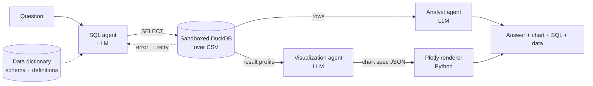

# Ask Your Data

**Ask questions about structured data in plain English.** An AI agent writes the SQL, the query runs against a real SQL engine, a second agent explains the result, and a third agent decides how to visualise it — all in a clean Streamlit app.

It's an open-source demo of a simple idea: large language models aren't just for text. Given a good description of your data, they can query it, reason over the numbers, and pick the right chart.

> All bundled data is **synthetic** (a fictional company, *Northstar Technologies*). No real people, budgets or projects.

---

## What it does

1. **Ask** — "Which expense categories are most over budget in 2026 YTD?"
2. **SQL agent** — reads the *data dictionary* (tables, columns, types, value profiles and plain-English definitions) and writes one DuckDB `SELECT`. If the database rejects it, the error is fed back and the agent repairs its own query.
3. **Database** — the query runs in a sandboxed, in-memory DuckDB engine over the CSV files.
4. **Analyst agent** — reads the result rows and streams a short, numbers-first answer.
5. **Visualization agent** — in parallel, looks at the question and the shape of the result and chooses a chart (bar, line, area, Gantt, heatmap, treemap, waterfall, funnel, scatter, histogram, box, donut or KPI tiles). Python + Plotly renders it.

Every answer shows the **generated SQL**, the **raw result** (downloadable) and an **agent trace** with timings and token counts, so viewers can see exactly how the answer was produced.



### Features

- **Three demo datasets**, each a small multi-table "database" with a full semantic layer and example questions:

  | Dataset | Tables | Good for |
  |---|---|---|
  | 💰 Finance · Budget vs Actuals | `departments`, `budget_actuals` (monthly opex by department × category), `revenue` (target vs actual by region × product) | variance analysis, YTD, remaining budget, attainment |
  | 👥 HR · People Analytics | `departments`, `employees` (579 current + former), `leave_records` | headcount, attrition, hiring trends, pay by level, absence |
  | 📅 PMO · Project Portfolio | `projects`, `tasks`, `team_members` | Gantt timelines, overdue tasks, budget burn, schedule slip |

- **Bring your own data** — upload CSVs (one table each). The app sniffs delimiters and encodings, infers types, suggests snake_case column names, and asks you to **define every column**. A "Draft definitions with AI" button fills in a first draft for you to review. A sample CSV is included for visitors who don't have one handy.
- **Conversation memory** — follow-ups like "now split that by quarter" work.
- **Anthropic Claude or OpenAI** — switchable in the sidebar; both use structured outputs (JSON schema) so every agent response is machine-checkable.
- **Login** — none, simple username/password, or Google/Microsoft/Okta single sign-on via Streamlit's native `st.login`.
- **Public-demo guardrails** — per-session question limit, query timeout, row cap, and a locked-down SQL sandbox (see [Security](#security--guardrails)).
- **Offline replay mode** — run the whole UI without an API key (pre-written SQL + chart specs for the example questions). Handy for development and CI.

---

## Quick start

```bash
git clone https://github.com/shahzeb5136/structured_data_llms_querying.git
cd structured_data_llms_querying
python -m venv .venv && source .venv/bin/activate      # Windows: .venv\Scripts\activate
pip install -r requirements.txt

cp .streamlit/secrets.toml.example .streamlit/secrets.toml
# edit .streamlit/secrets.toml → add your Anthropic (or OpenAI) API key

streamlit run app.py
```

No key yet? Either paste one into **Model settings** in the sidebar, or try the offline replay mode:

```bash
LLM_PROVIDER=offline streamlit run app.py
```

---

## Configuration

Settings come from `.streamlit/secrets.toml` (or the **Secrets** panel on Streamlit Community Cloud), then environment variables, then defaults. The fully commented reference is [`.streamlit/secrets.toml.example`](.streamlit/secrets.toml.example).

| Setting | Env var | Default | Notes |
|---|---|---|---|
| `[llm] provider` | `LLM_PROVIDER` | `anthropic` | `anthropic`, `openai` or `offline` |
| `[llm] model` | `LLM_MODEL` | `claude-sonnet-5-5` | any model id of the provider (OpenAI default: `gpt-5.4-mini`) |
| `[llm] anthropic_api_key` | `ANTHROPIC_API_KEY` | – | |
| `[llm] openai_api_key` | `OPENAI_API_KEY` | – | |
| `[llm] allow_user_api_keys` | `ALLOW_USER_API_KEYS` | `true` | visitors may paste their own key if no server key is set |
| `[llm] allow_model_choice` | `ALLOW_MODEL_CHOICE` | `true` | show the provider/model picker |
| `[llm] effort` | `LLM_EFFORT` | – | optional Anthropic `output_config.effort` (`low`/`medium`/`high`) |
| `[limits] max_questions_per_session` | `MAX_QUESTIONS_PER_SESSION` | `25` | `0` = unlimited |
| `[limits] max_result_rows` | `MAX_RESULT_ROWS` | `5000` | |
| `[limits] query_timeout_seconds` | `QUERY_TIMEOUT_SECONDS` | `15` | |
| `[access] mode` | `ACCESS_MODE` | `none` (or `password` if users exist) | `none`, `password`, `oidc` |
| `[access.users]` | `APP_USERNAME` / `APP_PASSWORD` | – | plain text or `sha256:<hex>` hashes |
| `[app] title`, `tagline`, `organization`, `organization_url`, `repo_url` | `APP_TITLE`, … | | branding + footer links |

> The section is called `[access]` (not `[auth]`) because Streamlit reserves `[auth]` for its native OIDC login settings.

---

## Deploy

### Streamlit Community Cloud (free, easiest)

1. Push this repository to GitHub.
2. On [share.streamlit.io](https://share.streamlit.io) choose **Create app** → your repo → main file `app.py`.
3. Under **Advanced settings → Secrets**, paste your `secrets.toml` content (at least an API key).
4. Deploy. To embed it on your website, use an iframe with `?embed=true`:

```html
<iframe src="https://<your-app>.streamlit.app/?embed=true" style="width:100%;height:900px;border:0"></iframe>
```

### Docker

```bash
docker build -t ask-your-data .
docker run -p 8501:8501 -e ANTHROPIC_API_KEY=sk-ant-... -e APP_PASSWORD=change-me ask-your-data
```

---

## Security & guardrails

The SQL is written by a language model and the app is public, so the database layer assumes the SQL could be hostile:

- **One read-only `SELECT` only.** The statement type is determined by DuckDB's own parser (`extract_statements`), not by regex. Multiple statements, DDL/DML, `COPY`, `ATTACH`, `INSTALL`, `SET` etc. are rejected.
- **No file system or network.** The in-memory engine runs with `enable_external_access = false` and `lock_configuration = true`, so queries can't read files (`read_csv('/etc/passwd')`), environment variables, or re-enable access.
- **Limits.** A per-query timeout (the query is interrupted), a result-row cap, memory and thread limits, and a per-session question limit.
- **No model-written code is executed.** The visualization agent returns a JSON chart *spec*; trusted Python renders it after validating it against the real result columns (with an automatic fallback chart).
- **Uploaded data stays in the session.** Files are parsed in memory and never written to disk. Column names, sample values and query results *are* sent to the configured AI provider — the upload page says so.
- **Prompt hygiene.** The question is treated as data; the SQL agent is told never to follow instructions that change its rules.

All of this is covered by tests (`tests/test_database.py`).

---

## Project structure

```
app.py                     # entry point: page config, login gate, navigation
core/                      # framework-agnostic logic (no Streamlit UI code)
  catalog.py               # datasets, semantic layer, CSV parsing, type inference, schema → prompt
  database.py              # sandboxed DuckDB query engine
  llm.py                   # Anthropic / OpenAI adapters (structured outputs + streaming)
  prompts.py               # agent prompts and JSON schemas
  pipeline.py              # SQL agent (+ self-repair), analyst agent, visualization agent
  charts.py                # chart spec → Plotly figures, colour-blind-safe palette
  offline_llm.py           # replay "LLM" for offline mode and tests
  config.py                # settings from secrets / env
ui/                        # Streamlit UI
  views/ask.py             # chat page
  views/catalog.py         # data catalog / semantic layer
  views/upload.py          # bring-your-own-CSV flow
  views/about.py           # how it works
  sidebar.py, auth.py, components.py, state.py, styles.py
data/<dataset>/            # CSVs + dataset.yaml (column definitions, business rules, example questions)
data/samples/              # sample CSV for the upload flow
scripts/generate_data.py   # regenerates all synthetic data (seeded, deterministic)
tests/                     # pytest suite (no API key or network needed)
```

---

## Extending

**Add a dataset.** Create `data/<id>/` with CSV files and a `dataset.yaml`:

```yaml
id: sales
name: Sales · Pipeline
icon: "📈"
description: One line about the data.
as_of_date: "2026-09-30"        # optional - used as "today"
currency: USD
tables:
  - name: opportunities
    file: opportunities.csv
    description: One row per sales opportunity.
    columns:
      - {name: opportunity_id, type: text, description: Unique opportunity key.}
      - {name: amount_usd, type: decimal, description: Deal value in US dollars.}
      - {name: close_date, type: date, description: Expected or actual close date.}
business_definitions:
  - "Win rate = won opportunities / closed opportunities."
example_questions:
  - What is the pipeline value by stage?
```

Column types: `text`, `integer`, `decimal`, `date`, `datetime`, `boolean`. The quality of the descriptions and business definitions is the single biggest lever on answer quality.

**Connect a real database.** `core/database.py` is the only place that executes SQL. Implement the same `validate()` / `execute()` interface against Postgres, Snowflake, BigQuery or SQL Server (use a read-only role!), and change the dialect line in `core/prompts.py`.

**Add a chart type.** Add the name to `CHART_TYPES` and describe it in `VIZ_SYSTEM` (`core/prompts.py`), then add a branch in `build_chart` (`core/charts.py`).

**Regenerate the demo data.** `python scripts/generate_data.py` (seeded, so output is identical every time).

---

## Development

```bash
pip install -r requirements.txt -r requirements-dev.txt
pytest -q          # ~100 tests, no network or API key required
ruff check .
```

The provider adapters are tested against mocked HTTP responses; the Streamlit pages are smoke-tested with `streamlit.testing.AppTest` in offline mode.

## License

MIT — see [LICENSE](LICENSE).
